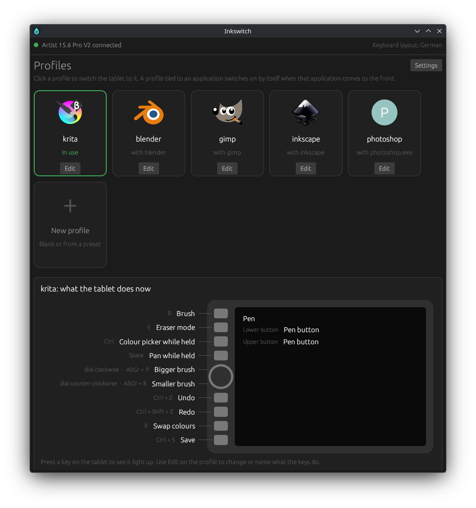
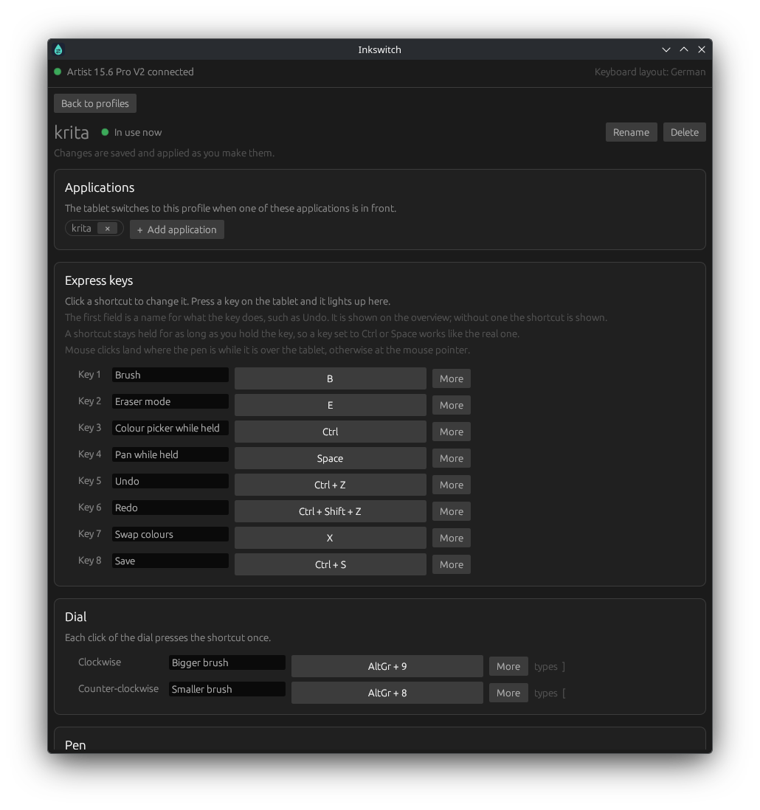

# Inkswitch

A driver and settings app for XP-Pen drawing tablets on Linux, with profiles that switch by
themselves depending on which application is in front.

Inkswitch replaces the vendor's driver. It reads the tablet directly, turns it into a pen the
desktop understands, and lets you decide what every express key, the dial and the pen buttons
do, separately for Krita, GIMP, Blender or any other application.

Inkswitch is an independent project. It is not made, endorsed or supported by XP-Pen.





## What it does

- **Per-application profiles.** Tie a profile to an application and the tablet switches to it
  when that application comes to the front. Switching is instant.
- **Express keys, dial and pen buttons.** Each one can press a shortcut (`Ctrl+Z`), hold a
  modifier for as long as it is held, play several shortcuts in a row, or click a mouse button,
  alone or combined (`Shift+Click`).
- **Shortcuts as on your keyboard.** They are shown and recorded in your keyboard layout, so a
  German keyboard shows `Ctrl + Z` for the key that says Z.
- **Names for shortcuts.** Call a key "Undo" and the overview shows the tablet with every
  control labelled.
- **Pressure curve** per profile, with soft, neutral and firm presets.
- **Presets** with the usual shortcuts of Photoshop, Krita, GIMP, Inkscape and Blender.
- **Key finder.** Press a key on the tablet and it lights up in the window.
- **Pen mapped to a screen** of your choice, for tablets with a display.

## Requirements

- Linux on a 64-bit Intel or AMD machine. The prebuilt packages need glibc 2.31 or newer
  (distributions from 2020 on).
- A tablet that speaks XP-Pen's current USB protocol (known as UGEE v2).
  **Only the Artist 15.6 Pro V2 has been tested.** Other models of the same generation should
  work, but the window assumes eight keys and one dial.
- **KDE Plasma 6 on Wayland** for automatic profile switching and for choosing the pen's screen.
  On other desktops the driver runs, and you pick the profile by hand.
- systemd, to run the driver in the background (not needed for the Flatpak).
- The official XP-Pen driver must not be running at the same time: both would claim the tablet.

## Installing

There are no published releases yet; build one of the packages below, or install from source.

### AppImage

```sh
packaging/build-appimage.sh          # writes dist/Inkswitch-x86_64.AppImage
chmod +x Inkswitch-x86_64.AppImage
./Inkswitch-x86_64.AppImage
```

Click **Set up and start** in the window (or run `./Inkswitch-x86_64.AppImage setup`). This
installs the background service, a menu entry and, after asking for the administrator
password, the rule that lets you use the tablet without being root.

### Flatpak

```sh
packaging/build-flatpak.sh           # writes dist/Inkswitch.flatpak
flatpak install --user Inkswitch.flatpak
```

Open Inkswitch from the menu and click **Set up and start**. A sandboxed application cannot
ask for the administrator password, so if you are not yet allowed to use the tablet the window
shows a short command to run once in a terminal.

The Flatpak keeps its own profiles, separate from the other ways of installing.

### From source

With a recent stable Rust toolchain:

```sh
cargo install --path .
inkswitch setup
```

Building the packages needs a few more tools: the AppImage script downloads `appimagetool`;
the Flatpak script needs `flatpak` and the `org.freedesktop.Platform//25.08` runtime. With
[cargo-zigbuild](https://github.com/rust-cross/cargo-zigbuild) installed both link against an
old glibc; without it the result only runs on systems as new as the one it was built on.

### Uninstalling

`inkswitch setup --remove` removes the background service and the menu entry and keeps your
profiles. The permission rule is the file `/etc/udev/rules.d/70-inkswitch.rules`.

## Using it

Run `inkswitch` (or open it from the menu) for the window:

- The main screen shows your profiles as tiles. Click one to switch the tablet to it. Below
  them is a drawing of the tablet with what each control does right now.
- **Edit** on a tile opens the profile: the applications it belongs to, the shortcuts, their
  names, the pen buttons and the pressure curve. Changes apply as you make them.
- **New profile** starts from a copy of the profile in use or from a preset.
- **Settings** holds the screen the pen draws on and what happens for applications without a
  profile.

Everything is also available from the terminal:

```
inkswitch list                           profiles and the applications tied to them
inkswitch use <profile>                  switch now
inkswitch new <name> --preset gimp       create a profile from a preset
inkswitch new <name> --from <profile>    create a profile as a copy
inkswitch bind <profile> <window-class>  tie an application to a profile
inkswitch unbind <window-class>
inkswitch remove <profile>
inkswitch status                         profile in use, tablet, last focused window
inkswitch probe --seconds 10             show what a connected tablet reports
inkswitch daemon                         run the driver in the foreground
```

Profiles are plain TOML files in `~/.config/inkswitch/profiles/`. Shortcuts are stored as key
positions, so they keep working when you change keyboard layout.

## How it works

`inkswitch daemon` claims the tablet's vendor interface over USB, switches it to full reports
and translates them into two virtual input devices: a pen, which the desktop treats as a
drawing tablet, and a keyboard with mouse buttons, which plays the shortcuts of the profile in
use. A small KWin script reports the focused window over D-Bus, and the daemon switches profile
accordingly.

## Known limits

- Mouse clicks in a shortcut are made with the pen while it is over the tablet, because the
  desktop's mouse pointer does not follow the pen. A left click is the tip touching down;
  middle and right click are the two pen buttons, which Qt applications (Krita) read that way
  and GTK applications (GIMP, Inkscape) read the other way round.
- No custom active area, rotation, or mouse (relative) mode.
- The dial has one function per profile; the vendor driver's extra dial modes are not there.
- The presets assume each application's default shortcuts.
- If the driver stops, the pen stays dead until it is started again or the tablet is replugged.

## License

MIT; see [LICENSE](LICENSE).

## Trademarks

XP-Pen and the product names of its tablets belong to their owner, as do the names of the
applications the presets are made for. They are used here only to say what Inkswitch works with.
